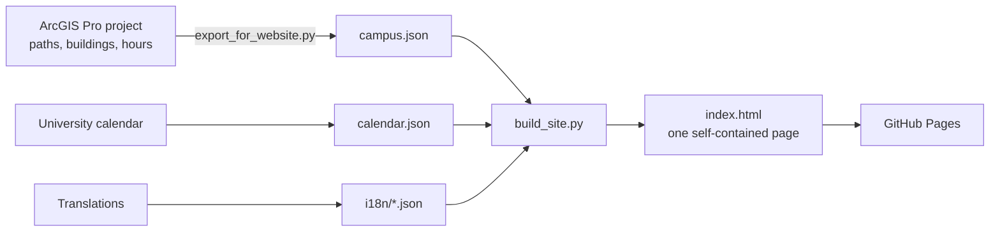

<div align="center">


# UT SmartMap

**Time-aware walking directions for the University of Toledo Main Campus.**
Routes change with the clock: when a building closes, the map stops sending you through it.

[](https://nhanhuynh2005.github.io/UT-Smartmap/)


</div>

---

## Contents

- [Why UT SmartMap](#why-ut-smartmap)
- [Features](#features)
- [Screenshots](#screenshots)
- [How it works](#how-it-works)
- [Privacy](#privacy)
- [Languages](#languages)
- [Project files](#project-files)
- [Updating the map](#updating-the-map)
- [Credits and data sources](#credits-and-data-sources)

---

## Why UT SmartMap

Most campus maps show where buildings are, but not **whether you can walk through them right now**.
At 8 PM a shortcut through a building may be locked; on a winter break every building may be closed.
UT SmartMap knows each building's hours and the university calendar, so the route it gives you is one you can actually walk **at the time you're walking**.

> **Not an official University of Toledo service.** This is a student GIS project by **Nhan Huynh**, Data Analytics, The University of Toledo.

---

## Features

| | Feature | What it does |
|:-:|---|---|
| 🕒 | **Routes that follow the clock** | Uses the current campus time (Eastern Time) by default. Closed buildings are avoided; the route shows the detour they cause. |
| 📅 | **University calendar** | On days when offices are closed, every building is treated as closed. Break days without classes keep normal hours. |
| 🏢 | **Prefer indoors** | Cold or rain? Choose how many extra minutes you'll accept to walk more of the way inside open buildings. |
| 📍 | **Live location tracking** | Follow your position as you walk. The route and minutes update, and the map tells you when you arrive. |
| 🗣️ | **Step-by-step and spoken directions** | Every turn written out, read aloud on request, and announced as you walk with voice guidance. |
| 🧭 | **Compass and map rotation** | North, east, south or west up, two-finger twist, or let your phone's compass face the map your way. |
| 🛰️ | **Two backgrounds** | A clean *Simple* map or *Satellite* imagery. |
| 🌐 | **10 languages** | English, Tiếng Việt, 日本語, हिन्दी, नेपाली, 简体中文, 한국어, العربية, Español, Français. |
| 📱 | **Works on phones** | Bottom-sheet menu, large touch targets, pinch to zoom, drag A or B to an exact door. |
| ♿ | **Accessible by design** | Keyboard friendly, screen-reader labels, colour-blind-safe colours, and *reduced motion* respected. |
| 🆕 | **Updates panel** | A public "What's new" log, one entry per day, in every language. |

---

## Screenshots

<table>
  <tr>
    <td align="center" width="50%">
      <br>
      <sub><b>Live tracking</b>: your position, the route ahead and the next turn.</sub>
    </td>
    <td align="center" width="50%">
      <br>
      <sub><b>Your language</b>: the whole interface in Tiếng Việt.</sub>
    </td>
  </tr>
</table>

---

## How it works



1. **The data comes from ArcGIS Pro.** The walking network (outdoor and indoor paths with a `Walk_time` in minutes), building outlines and opening hours are exported to `campus.json`.
2. **Everything is built into one page.** `build_site.py` puts the data, the calendar, the routing engine and the translations into a single `index.html`. No server or database is needed.
3. **Your browser finds the route.** When you choose a start, destination and time, the page:
   - works out which buildings are closed at that moment (or on that calendar day),
   - blocks the paths inside them,
   - finds the fastest route with **Dijkstra's algorithm**, using real walking minutes.
4. **It matches ArcGIS Pro.** Presidents Hall → University Hall at 20:30 comes out at **1,185 m** on the website and **1,186 m** in the ArcGIS Pro network.

---

## Privacy

- 🔒 **No accounts, cookies or analytics.** The page doesn't record who visits.
- 📍 **Your location never leaves your phone.** Live tracking only runs while you switch it on, and your position is never sent, saved or put in a link.
- 🧭 **The compass reading stays on your device** as well.
- 🛰️ **Satellite photos** come from Esri, which, like any website, can see your IP address. The default *Simple* map loads nothing from outside.
- 🛡️ The page runs with a strict browser security policy, and it only remembers small preferences (language, base map) on your own device.

---

## Languages

English · Tiếng Việt · 日本語 · हिन्दी · नेपाली · 简体中文 · 한국어 · العربية · Español · Français

The page picks your device's language automatically, and you can switch with the 🌐 globe button.
**Building names stay in English** so they match the signs on campus.

> 💬 **Native speakers welcome!** If a translation sounds unnatural, open an issue or edit the matching file in `i18n/` (for example `i18n/ne.json`).

---

## Project files

| File | Purpose |
|---|---|
| `index.html` | The website. This is the only file GitHub Pages needs. |
| `export_for_website.py` | Runs in ArcGIS Pro and exports the campus data to `campus.json`. |
| `build_site.py` | Builds `index.html` from the template, data, calendar and translations. |
| `page_template.html` | Layout, styles and map drawing. |
| `engine.js` | The routing engine (same rules as the ArcGIS Pro network). |
| `calendar.json` | University closure days. Update once a year. |
| `updates.json` | The public "What's new" log. |
| `i18n/*.json` | The interface text in each language. |

---

## Updating the map

```bash
# 1. In ArcGIS Pro: run export_for_website.py  ->  campus.json
# 2. On your computer, in the project folder:
python build_site.py
# 3. Upload the new index.html to this repository (replace the old one)
```

The live site updates a minute or two after the upload.

---

## Credits and data sources

- **Campus data and walking network:** Nhan Huynh, built in ArcGIS Pro.
- **University calendars:** [UToledo Academic Calendar](https://www.utoledo.edu/offices/provost/calendar/) and [HR Holiday Calendar](https://www.utoledo.edu/depts/hr/work-life-harmony/docs/holiday-calendar.pdf).
- **Satellite imagery:** Source: Esri, Maxar, Earthstar Geographics, and the GIS User Community.
- **Typeface:** [Poppins](https://fonts.google.com/specimen/Poppins) via Google Fonts.

<div align="center">

---

Made with ☕ and a lot of walking across Main Campus. **Go Rockets!** 🚀

</div>
